<p align="center">
  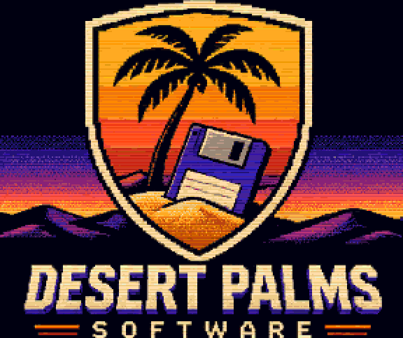
</p>

<h1 align="center">Oasis</h1>

<p align="center">
  <b>A two-pane file manager for the classic Amiga, Kickstart 1.3 and up.</b><br>
  Freeware by Paul Seibert &middot; &copy; 2026 Desert Palms Software
</p>

<p align="center">
  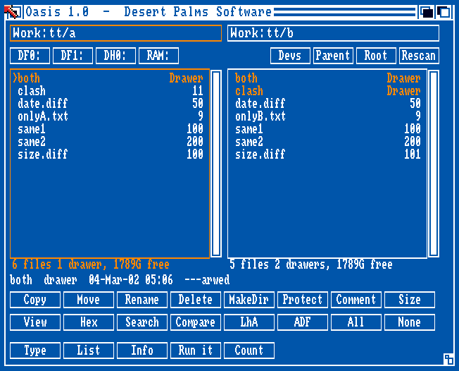
</p>

<p align="center">
  <a href="https://github.com/PaulSeibert/amiga-oasis/releases/latest"><b>Download Oasis 1.0</b></a> &middot;
  <a href="Oasis.readme">Aminet readme</a>
</p>

---

Oasis is a file manager in the classic two-pane style: a source pane and a destination pane
side by side, a bank of buttons underneath, and everything done from one window. It is
written in C against the **AmigaOS 1.3** includes, so it runs on a stock A500 with 512K,
and it runs unchanged on AmigaOS 2.x and 3.x.

Besides copying files it **looks at them** (text, hex, IFF pictures and sounds), **looks
inside LhA archives** without needing LhA, and **turns floppies into ADF images and back**,
which is handy now that most Amiga software travels as .adf and .lha files. It is about
100 KB, needs nothing beyond the ROM, and was tested with automated test disks on
Kickstart 1.3 and 3.1.

## Contents

- [Features](#features)
- [Screenshots](#screenshots)
- [Download and install](#download-and-install)
- [Using Oasis](#using-oasis)
- [Settings and custom buttons](#settings-and-custom-buttons)
- [Command mode](#command-mode)
- [Known limits](#known-limits)
- [Building from source](#building-from-source)
- [Testing](#testing)
- [Repository layout](#repository-layout)
- [Credits and license](#credits-and-license)

## Features

**Browsing**
- Two panes, each with a path field, scroller and status line (files, drawers, selection
  size, free space). The active pane, the source, has the orange frame.
- Drive buttons for the drives you have, plus **Devs** (devices, volumes and assigns),
  **Parent**, **Root** and **Rescan**. Disk changes are noticed.
- The info line describes the entry under the cursor: **what kind of file it is** (from its
  contents: program, text, ILBM picture, 8SVX sound, LhA archive, ADF image, icon, ...),
  size, date, protection bits and comment.
- Keyboard: cursor keys (Shift for a page), Return opens, Backspace goes up, Space selects,
  Tab switches panes, Del deletes. Sort by name, size or date; hide `.info` files.

**File operations**
- **Copy, Move, Rename, Delete, MakeDir**, through whole drawers.
- **Icons travel with their files**: copying `foo` copies `foo.info`.
- **Comments, protection bits and dates are kept**, on 1.3 too (with an `ACTION_SET_DATE`
  packet, as 1.3 has no `SetFileDate`).
- Moves on one disk are renames; across disks the original is deleted only if the copy
  arrived complete.
- A progress bar, and **Esc stops cleanly**: no half files are left behind.
- Requesters for everything that can go wrong: Retry / Skip / Skip all / Abort, Replace /
  Replace all, Unprotect. Deletes always ask first; copying a drawer into itself is refused.

**Tools**
- **Protect**: the `hsparwed` bits as toggles. **Comment**: edit a file comment.
- **Size**: add up drawers; their sizes then show in the list.
- **Search** by name below the current drawer, with AmigaDOS wildcards (`#?` `?` `*`
  `(a|b)`) or part of a name. The results fill the pane: copy or delete them directly, or
  double-click one to go to it.
- **Compare**: selects what exists on only one side, or differs in size or date.
- **Custom buttons**: up to 12, from a plain text prefs file.

**Viewers**
- **Text**: long lines wrap, tabs line up, ANSI colour codes in readmes are hidden.
  **Hex**: any size of file. Tab switches between them.
- **IFF ILBM pictures** on their own screen: lores and hires, interlace, up to 32 colours,
  Extra Halfbrite and HAM.
- **IFF 8SVX sounds**, plain or Fibonacci-packed, mono or stereo, streamed to
  `audio.device` through small chip RAM buffers.

**LhA archives**
- Return on an `.lha` lists it: sizes, packing, dates, drawers and Amiga file comments.
  **This is built in and works without LhA** (header levels 0, 1 and 2).
- The **LhA** button extracts archives into the other pane, or packs the selection (with
  its icons) into a new archive there, using your LhA program (shareware, not included).

**ADF disk images**
- **Write an .adf to a floppy** in DF0:-DF3:, with or without verifying each track. Oasis
  names the disk it is about to replace and asks first.
- **Read a floppy into an .adf**. Unreadable tracks are saved as zeros and reported, so a
  damaged disk can still be rescued in part.
- Write-protected disks, empty drives, images of the wrong size and images stored on the
  disk being imaged are all refused.

## Screenshots

| Kickstart 1.3 | Kickstart 3.1 |
|---|---|
|  | 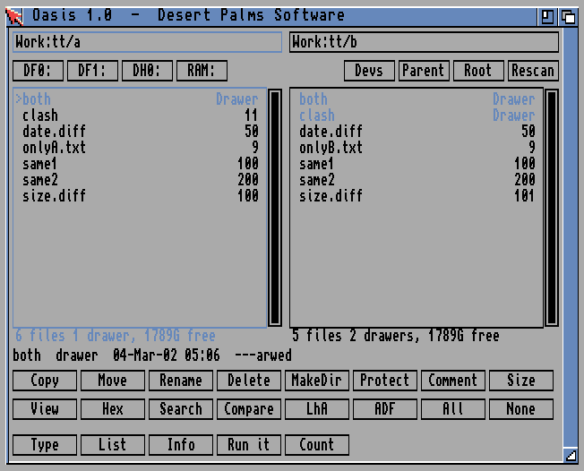 |

| Protect | Search results |
|---|---|
| 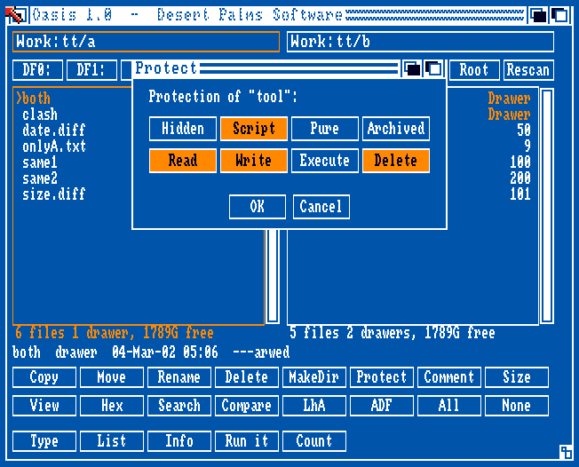 | 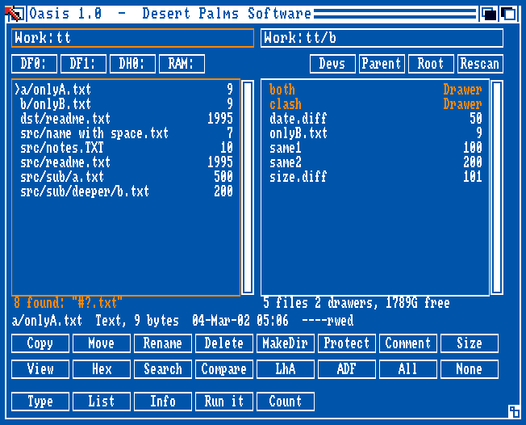 |

| Compare | Text viewer |
|---|---|
| 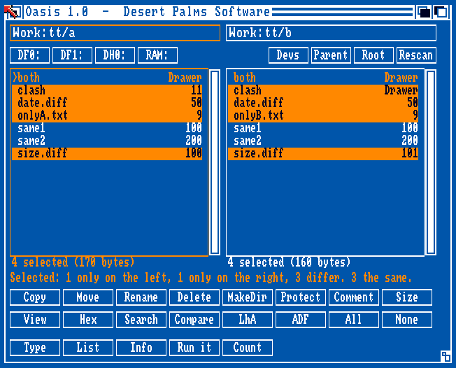 | 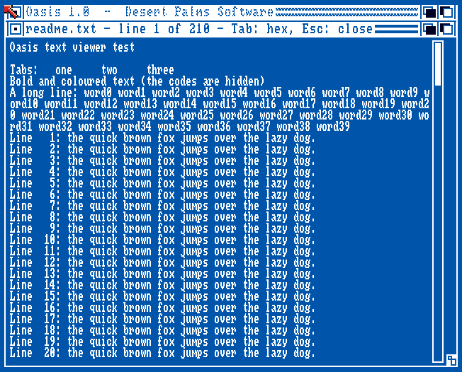 |

| IFF picture | LhA archive |
|---|---|
| 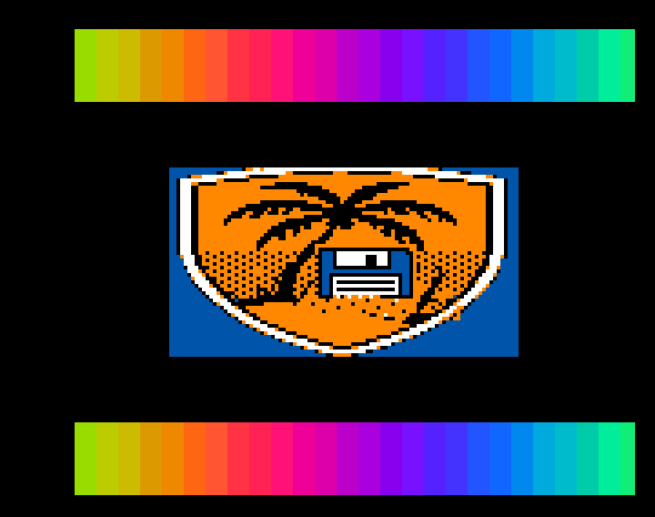 | 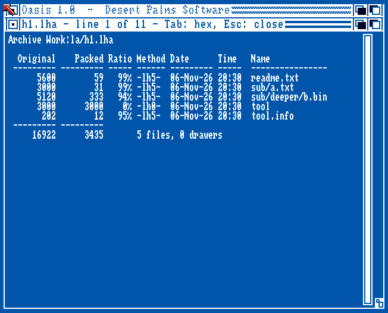 |

| LhA button | ADF button |
|---|---|
| 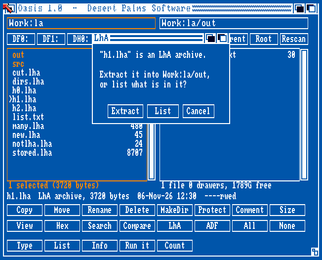 | 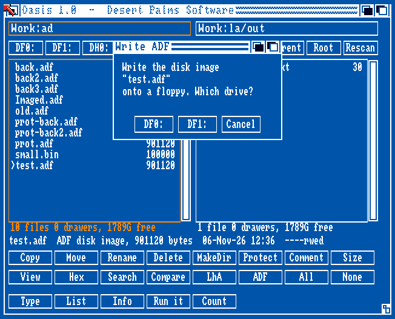 |

## Download and install

Get **Oasis.lha** from the [latest release](https://github.com/PaulSeibert/amiga-oasis/releases/latest)
and unpack it anywhere, for example to `SYS:Utilities`. It contains:

```
Oasis.info              drawer icon
Oasis/Oasis             the program (and its icon)
Oasis/Oasis.readme      the Aminet readme (opens with More)
Oasis/Oasis.prefs       example settings, with every option explained (opens with Ed)
```

The release also has **oasis.adf**, a disk that boots straight into Oasis: put it in
DF0: (or a Gotek, or an emulator) and switch on.

Oasis needs no libraries, fonts or assigns beyond the ROM. On Kickstart 1.3, custom buttons
and LhA need `C:Run`, which every Workbench disk has.

## Using Oasis

Double-click the Oasis icon, or type `oasis` in a CLI (`oasis Work: DF0:` opens the panes on
those drawers). Click an entry to select it; most buttons work on the selection, or on the
cursor entry if nothing is selected. Copy and Move go from the orange-framed pane to the other.

| Button | What it does |
|---|---|
| Copy / Move | to the drawer in the other pane |
| Rename / Delete / MakeDir | in this pane |
| Protect / Comment / Size | change or add up the selection |
| View / Hex | look at the file under the cursor |
| Search / Compare | find by name below this drawer / compare the two panes |
| LhA | extract or list archives, or pack the selection into one |
| ADF | write the image under the cursor to a floppy, or read a floppy into an image |
| All / None | select everything / nothing |

## Settings and custom buttons

Settings live in `S:Oasis.prefs`, or in `Oasis.prefs` next to Oasis, a plain text file.
**Project > Reload prefs** applies changes without restarting.

```
LEFT "Work:"                         ; the drawers the panes open on ("" = device list)
RIGHT ""
SORT NAME                            ; NAME, SIZE or DATE
HIDEICONS NO
BUTTON "Read" Type %f                ; custom buttons: up to 12
BUTTON "Edit" QUIET Run Ed %f
BUTTON "Play" QUIET Run Work:Tools/Player %s
LHA "C:LhA"                          ; the LhA program, and its command lines if needed
LHAEXTRACT %l x %a %d
LHAPACK %l -r a %a %n
```

In a button: `%s` the selected entries (quoted full paths), `%f` the first of them, `%p`
this drawer, `%d` the other pane's drawer, `%%` a percent sign. Commands run in the source
drawer; their output appears in a window that waits for Return, or nowhere with `QUIET`.

## Command mode

`oasis CMD ...` runs Oasis's engine from the CLI or a script, without the window. The test
suites use it, and it is handy for scripts. `oasis CMD` alone lists every command:

```
oasis CMD COPY Work:Projects TO DF1:          ; copy with icons, comments, dates
oasis CMD DELETE RAM:t FORCE
oasis CMD SEARCH Work: #?.mod
oasis CMD COMPARE Work:Backup DF1:
oasis CMD TYPE Work:Downloads/game.lha Work:Downloads/intro.iff
oasis CMD LHALIST Work:Downloads/game.lha
oasis CMD ADFWRITE RAM:game.adf DF0: VERIFY
oasis CMD ADFREAD DF0: Work:Disks/backup.adf
```

The other commands are LIST, TREE, DEVS, MOVE, MAKEDIR, RENAME, SIZE, PROTECT, COMMENT,
MATCH, PREFS, BUTTON, LINES, ILBM, PLAY, LHAX, LHAA, ADFINFO and MEM.

## Known limits

- **ADF imaging** is for 880K DD floppies (HD geometry needs OS 2.0 or later).
- **Pictures**: what the original chipset can show. AGA pictures (more than 64 colours) are
  recognised but not shown.
- **Sounds**: plain and Fibonacci-delta 8SVX.
- **Extracting and packing** need the LhA program, which is shareware and not included.
  Listing works without it.
- **It was tested in WinUAE only**: Kickstart 1.3 on an A500 (OCS, 512K + 512K) and
  Kickstart 3.1 (ECS, 1MB + 1MB). Writing ADFs has not yet been tried on a real floppy
  drive. Keep a copy of any disk that matters before writing an image over it.
- **Extract and pack** were tested with a stand-in that checks the commands Oasis gives
  LhA, not with LhA itself.

## Building from source

You need:

- **Docker**, to run the [`amigadev/crosstools:m68k-amigaos`](https://hub.docker.com/r/amigadev/crosstools)
  image. It provides [bebbo's amiga-gcc](https://github.com/bebbo/amiga-gcc) (GCC 6.5 for
  m68k-amigaos), `xdftool` from [amitools](https://github.com/cnvogelg/amitools), and `lha`.
- **Python 3**, for the tools that turn the ASCII art in `art/` into icons and image data.

```sh
./build.sh       # build/oasis, build/oasis.info, build/oasis.adf (a test disk)
./release.sh     # dist/Oasis.lha, dist/Oasis.readme, dist/oasis.adf
```

The compiler runs with `-mcrt=nix13 -m68000`: libnix startup code for Kickstart 1.3, plain
68000 code, and the 1.3 includes, so nothing newer than 1.3 can be called by accident.

## Testing

No Kickstart ROMs or Workbench files are included. The test disks borrow a few commands
(`Echo`, `FailAt`, `Run`, ...) from **your own** Workbench 1.3 disk image, given in `WB13_ADF`.
Each script builds a boot disk that runs `oasis CMD` steps and writes results to a host
folder mounted as `Work:`; a Python checker then compares them on the PC.

| Script | Checker | What it checks |
|---|---|---|
| `testops.sh` | `tools/checkops.py` | copy / move / delete / rename across Work:, RAM: and a floppy: trees, sizes, protection, comments, dates, byte-for-byte contents, refusals, memory |
| `testtools.sh` | `tools/checktools.py` | size, search, wildcards, protect, comment, compare, prefs parsing, custom buttons |
| `testview.sh` | `tools/checkview.py` | file types, text layout, every decoded ILBM plane against its source, 8SVX playing times, memory |
| `testlha.sh` | `tools/checklha.py` | listing archives made by LHa for UNIX (header levels 0/1/2), LhA command lines via a logging stand-in |
| `testadf.sh` | `tools/checkadf.py` | writing and reading ADF images on emulated drives (writable, write-protected, empty), byte for byte |
| `testgui.sh N` | (screenshots) | builds that open a dialog or view at start, for screenshots |

`tools/testmatch.c` unit-tests the wildcard matcher on the host. Every suite passes on
Kickstart 1.3 and 3.1, and no memory is lost on a second round of any of them.

## Repository layout

```
src/            C sources (ui, pane, ops, tools, match, prefs, view, ilbm, svx, lha, adf, cmd, ...)
art/            icons and logo as ASCII art (one character per pixel)
tools/          icon and image converters, test checkers, test media generator (mkiff.py)
examples/       example prefs files
docs/media/     screenshots and animation
Oasis.readme    Aminet readme (shipped in the archive)
build.sh        build the program, icon and a test disk
release.sh      build the release archive and boot disk
test*.sh        the test disks described above
```

## Credits and license

**Oasis** was written by **Paul Seibert**, © 2026 **Desert Palms Software**.

Oasis is **freeware**. See [LICENSE](LICENSE) for the terms. In short: free to use and to
copy unchanged, including on Aminet, cover disks and collections; no warranty.

Built with [bebbo's amiga-gcc](https://github.com/bebbo/amiga-gcc) and libnix,
[amitools](https://github.com/cnvogelg/amitools) and LHa for UNIX, and tested in
[WinUAE](https://www.winuae.net/). Amiga is a trademark of its respective owner.

<p align="center">
  <br>
  <b>Desert Palms Software</b>: new software for classic Amiga computers.
</p>
